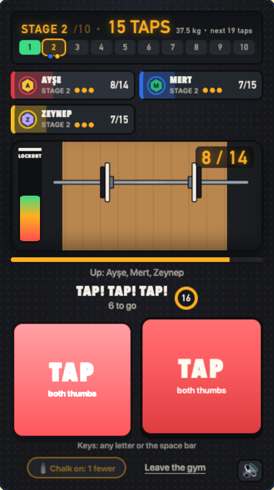
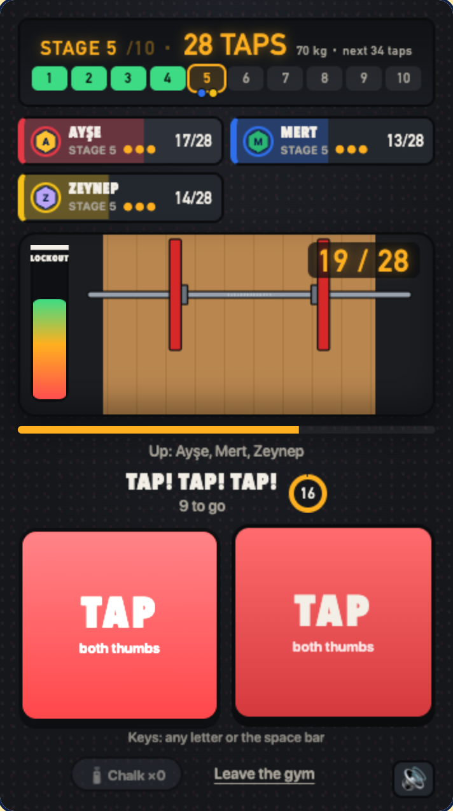
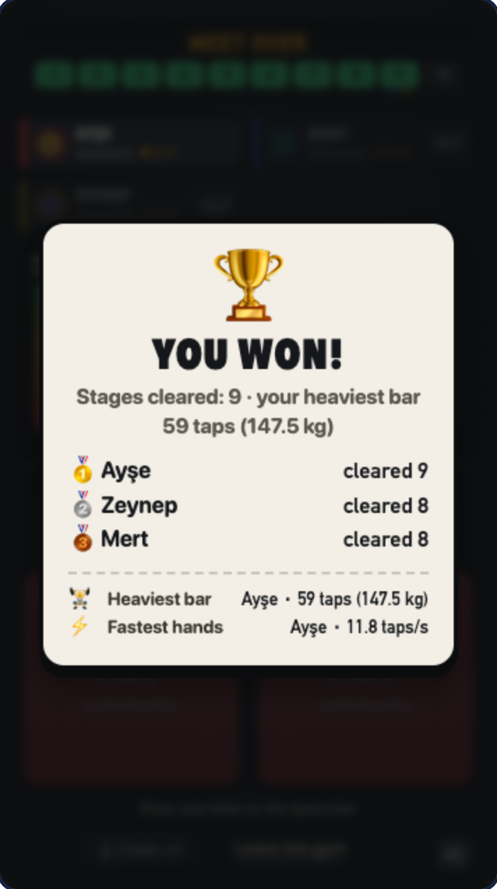

# Ağırlık Kapışması

Made with the [Kampüse Games Kit](https://github.com/kampuseapp/games-kit). One of three games for Kampüse's gym
(spor salonu), with Tenis and Basket 1v1.

**Players:** 2 to 4  
**Seconds per turn:** 16  
**Languages:** Turkish and English

### The game

A ladder of ten stages, climbed side by side on two big tap pads. A stage is a number of taps: get them all in
within five seconds and you are on the next one.

- The ladder is drawn when the meet starts. The first stage asks for 10 to 14 taps, and every stage after it a few
  more, and more of them the higher it goes. Each tap is 2.5 kg on the bar.
- Everyone lifts at the same time, each at the stage they are on. Make it and you go up; miss it and it costs one
  of three lives, and the same stage comes again.
- Out of lives, out of the meet. The last lifter still in wins; so does whoever clears the top of the ladder.
- Taps on a bar that was missed decide nothing. Level on stages, whoever got to theirs first is ahead.
- Once a meet you may chalk up before a bar: it asks you for a tenth fewer taps.

Everyone's count climbs live on every screen. The screen records the taps; the rules count them, and the table's
clock keeps them honest. A seat played by a bot lifts at a fixed, slow pace.

### Screenshots

    

    

    

