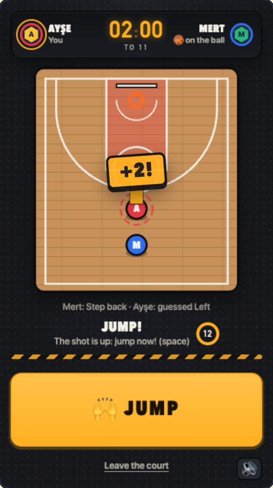
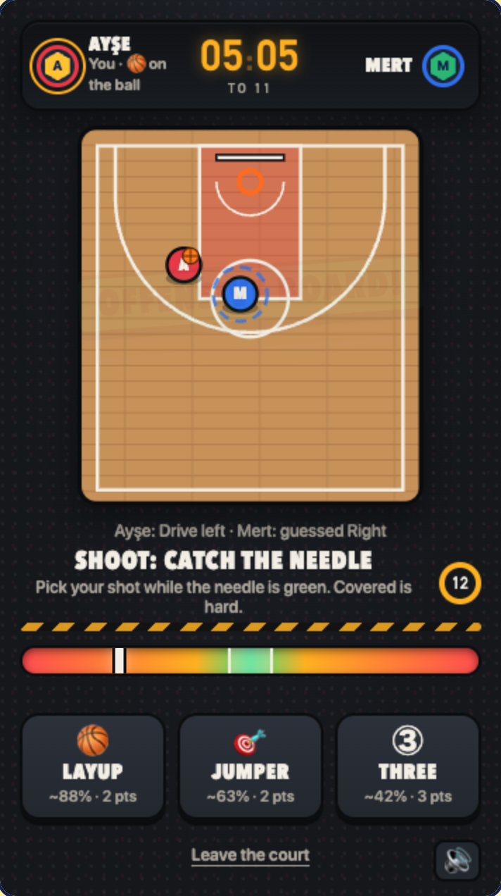
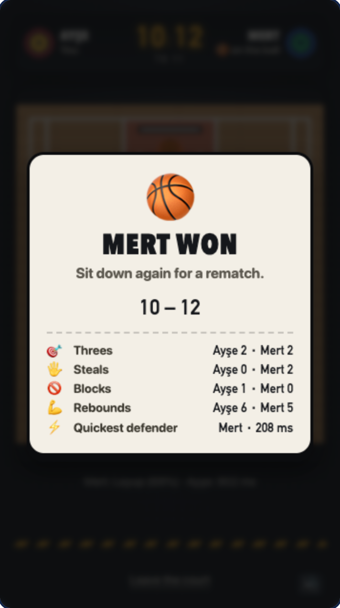

# Basket 1v1

Made with the [Kampüse Games Kit](https://github.com/kampuseapp/games-kit). One of three games for Kampüse's gym
(spor salonu), with Tenis and Ağırlık Kapışması.

**Players:** 2  
**Seconds per turn:** 12  
**Languages:** Turkish and English

### The game

Half-court streetball, first to 11, played on reflexes. A possession:

1. **The drive.** The attacker drives left, right or steps back. The defender may gamble on a guess (right: a good
   chance to steal; wrong: beaten) or wait and react.
2. **The reaction.** A waiting defender sees the move and has to slide the same way, fast. Quick and right: in the
   attacker's face, maybe a steal. Slow: trailing. Wrong or too slow: beaten.
3. **The shot.** A layup, a jumper or a three, released on a moving meter. How good the release is and how close
   the defender stayed set the shot's chance.
4. **The contest.** The defender jumps as the ball goes up. Quick jumps hurt the shot, and in close they block it.
5. **A miss.** Both go for the rebound at once; the faster hand wins it.

Layups and jumpers are 2 points, threes are 3. The screen measures the reflexes, and the table's clock keeps them
honest.

### Screenshots

    

    

    

