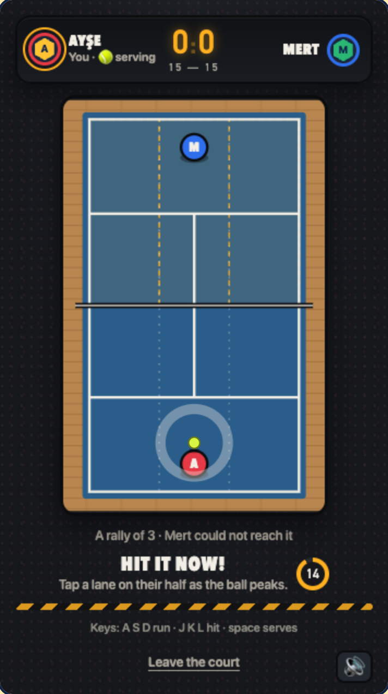
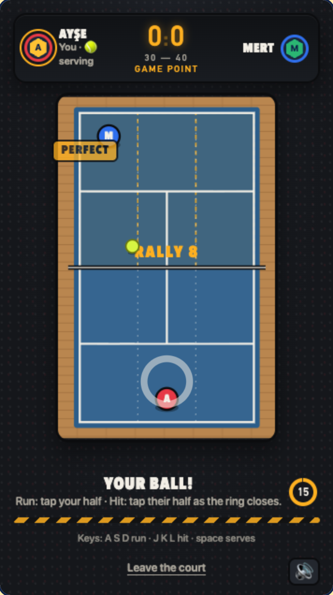
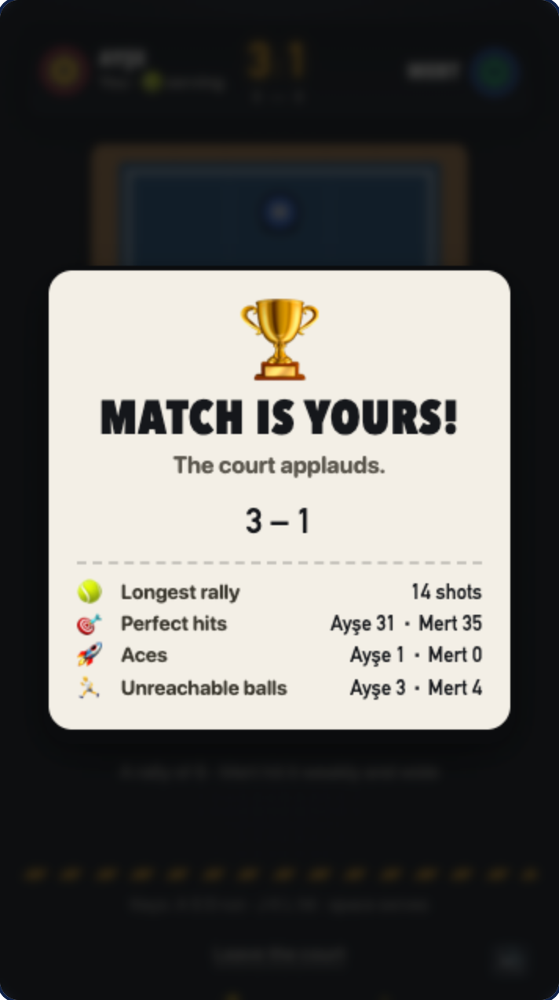

# Tenis

Made with the [Kampüse Games Kit](https://github.com/kampuseapp/games-kit). One of three games for Kampüse's gym
(spor salonu), with Basket 1v1 and Ağırlık Kapışması.

**Players:** 2  
**Seconds per turn:** 15  
**Languages:** Turkish and English

### The game

A rally played with your thumbs on a three-lane court. Nothing is rolled: every point is won or lost by running
and timing.

- The ball flies to a lane on your side. Tap your half to run there; tap their half to hit. Where you tap is where
  the ball goes, and when you tap is how well you hit it.
- Timing is judged against the moment the ball reaches you: perfect is a fast drive, good is a rally ball, weak is
  a slow lob. A weak hit aimed at a side lane sails out, and a perfect hit on a lob is a smash.
- The serve is a toss, then a tap on a lane as the ball peaks. Off the mark is a fault; two faults are a point.
- You may start running on a hunch before the ball is hit: right, and you reach anything; wrong, and you are
  stranded.

The rally speeds up with every shot. No-ad scoring, first to three games. The screen measures the taps, and the
table's clock keeps the times honest.

### Screenshots

    

    

    

